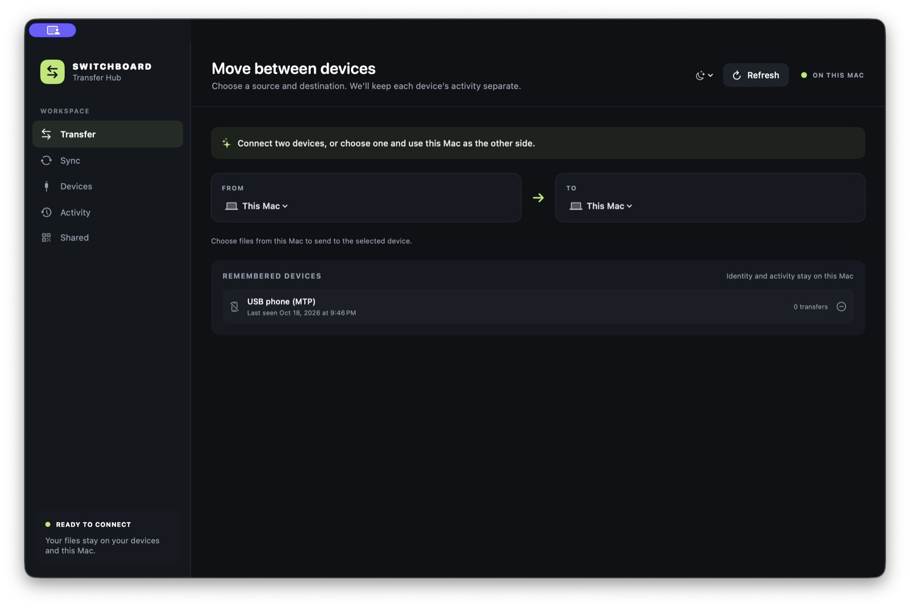
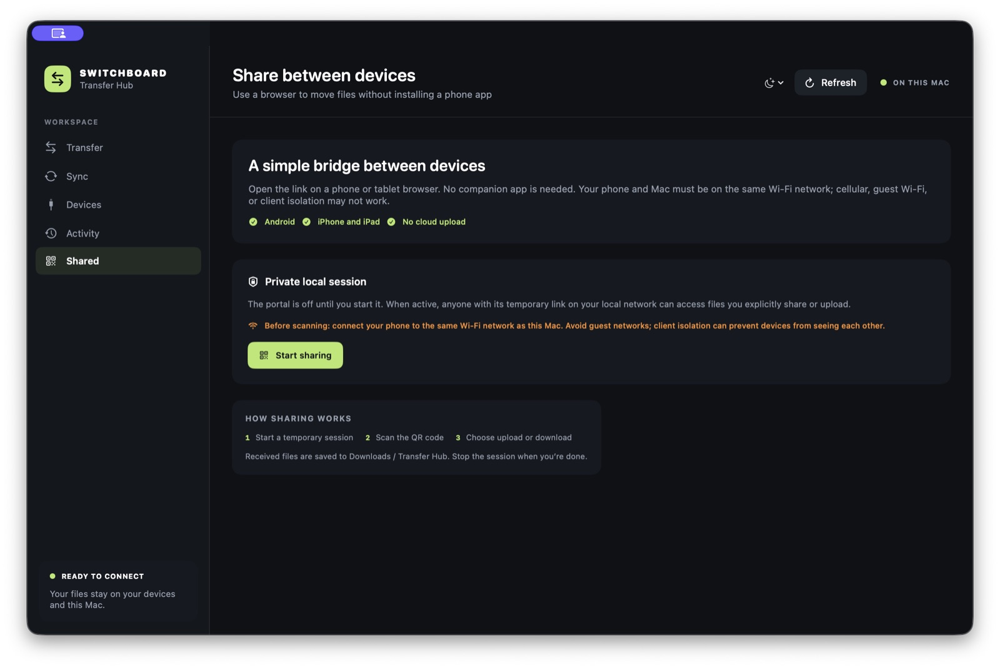

# SwitchBoard — Android File Transfer for Mac

SwitchBoard is a native macOS app for browsing and transferring files between Android phones and a Mac. Connect over USB with MTP or ADB, move files between selected endpoints, and use a QR-based local Wi-Fi portal to exchange files with a phone or tablet browser. The current macOS app is named **Transfer Hub**.

> Early access: this is an unsigned-for-distribution, non-notarized build. macOS Gatekeeper may warn that Apple cannot verify the developer. Read [Installing the non-notarized build](#installing-the-non-notarized-build) before opening it.

Visit the [SwitchBoard public website](https://adityarajpt.github.io/SwitchBoard/) for the beginner-friendly overview and visual guides.

New to Android file transfers? Start with the [plain-English guide to moving photos and files from your phone to your Mac](docs/transfer-android-photos-to-mac-beginner.md)—no technical setup knowledge needed.



## Screenshots

Choose a source and destination explicitly. With multiple Android devices connected, SwitchBoard keeps the endpoints separate; transfers are staged through the Mac so they can be retried.


The Shared page explains local-network access before the Wi-Fi portal starts. The Mac and phone must be on the same Wi-Fi network; guest Wi-Fi or router client isolation can prevent the connection.



Screenshots show the app interface without a phone connected; hardware transfer behavior depends on the selected transport and device setup.

## Android file transfer features

- Browse Android shared storage over USB MTP or ADB, search folders, preview files with Quick Look, and select multiple files for bulk download.
- Upload multiple Mac files, copy/paste files between phone folders where supported, and review per-device transfer history.
- Retry interrupted transfers; ADB file transfers and browser uploads can resume from saved partial data where supported by their transport.
- Move files between two connected Android endpoints. Transfers are staged through this Mac.
- Create manual folder-sync rules for Android devices, preview planned changes, review conflicts, then apply deliberately. Background sync is off and deletions are not propagated.
- Use the local Wi-Fi browser portal to upload selected phone files to the Mac or download files explicitly shared from the Mac. The portal requires no phone app and does not upload to a cloud service.
- Choose Automatic, Light, or Dark appearance.

## Supported connection methods

| Connection | What it supports | Notes |
| --- | --- | --- |
| USB MTP | Android file browsing, transfers, and folder sync | Unlock the phone and choose **File transfer** in its USB notification. The bundled OpenMTP helper may require Rosetta on Apple silicon. |
| USB or wireless ADB | Android browsing, transfers, and folder sync | Install Android Platform-Tools. USB debugging must be enabled and this Mac authorized; wireless ADB must first be paired in Android Wireless debugging. |
| Local Wi-Fi browser | Mac ↔ phone/tablet file exchange | Scan the QR code or open the link on a device on the **same Wi-Fi network**. This portal is not currently a paired endpoint for Android-to-Android transfer or folder sync. |
| iPhone/iPad browser | Upload/download through the local Wi-Fi portal | Direct iOS storage browsing and folder sync are not supported by this build. |

## Download and install

Download the latest build from [GitHub Releases](https://github.com/adityarajpt/SwitchBoard/releases/latest). Choose the `.dmg` disk image for the usual drag-to-Applications installation, or the `.zip` if you prefer to extract the app bundle yourself. These early-access builds target macOS 14 or later and Apple silicon Macs.

### Installing the non-notarized build

This build is not signed with a Developer ID certificate and has not been notarized by Apple. Gatekeeper may show an “unidentified developer” or “Apple cannot check it for malicious software” warning. This warning is expected for this release; it is not an Apple security review. Only proceed if you downloaded the app from this project’s official Releases page and trust the source.

1. Download `SwitchBoard-0.1.0-macOS-arm64.dmg` and open it. Drag **Transfer Hub.app** to the Applications shortcut in the disk image. If you downloaded the `.zip`, extract it and move the app to Applications instead.
2. Control-click **Transfer Hub.app** in Finder, choose **Open**, then choose **Open** again in the confirmation dialog. You only need this override the first time.

Do not disable Gatekeeper globally. A future distribution build can use Apple Developer ID signing and notarization to avoid this first-launch warning; those are not included here.

## Android setup

### USB file transfer with MTP

Connect the phone with a data-capable USB cable, unlock it, open the USB notification, and select **File transfer**. In Transfer Hub, choose **Devices → Scan USB**. MTP does not require Android USB debugging. If MTP is not detected, try another cable/port and keep the phone unlocked.

### Android Debug Bridge (ADB)

Install Android SDK Platform-Tools (`adb`), enable **Developer options → USB debugging**, connect the phone, and approve this Mac’s RSA authorization prompt. Transfer Hub searches `PATH` and common Android SDK locations; use **Locate adb** if it is installed elsewhere. For wireless ADB, pair the Mac in **Developer options → Wireless debugging** while both devices are on the same local network.

## Android transfer guides

Plain-English walkthroughs first, followed by more detailed help for specific connections:

- [Move photos and files from Android to Mac — beginner guide](docs/transfer-android-photos-to-mac-beginner.md) — simple cable instructions, what to tap, and where your files go.
- [Send files without a cable — beginner Wi-Fi guide](docs/share-files-android-mac-without-cable-beginner.md) — scan a QR code and transfer through your phone's browser.
- [How to transfer files from Android to Mac](docs/android-file-transfer-to-mac.md) — compare connection methods and learn about more options.
- [Android phone not showing on Mac over USB?](docs/android-mtp-not-working-on-mac.md) — troubleshoot the cable, USB mode, device discovery, and MTP helper.
- [Transfer files from Android to Mac over Wi-Fi](docs/transfer-files-android-mac-wifi.md) — detailed same-network setup and troubleshooting.
- [Sync folders between Android devices](docs/sync-folders-between-android-devices.md) — configure a deliberate, preview-first folder sync through the Mac.

## Local Wi-Fi sharing and privacy

Start **Shared → Start sharing** on the Mac, then scan the QR code with the phone camera. The phone and Mac must be connected to the same Wi-Fi network. Cellular data, guest networks, VPNs, firewalls, or router client isolation may block the connection. Received files are saved to `~/Downloads/Transfer Hub`.

The portal is off until started and stops when you choose **Stop portal**. It uses a temporary tokenized HTTP address on the local network, not end-to-end encrypted HTTPS. Anyone who can access the temporary link while the portal is active may upload files or download files you explicitly shared. Use a trusted private network and stop the portal when finished. Transfers are local; this app does not send your files to a cloud service.

## Build from source

Requirements: Xcode Command Line Tools or Xcode, Swift 6, and macOS 14 or later. To build and launch locally:

```sh
swift test
./build-app.sh
open "Transfer Hub.app"
```

`build-app.sh` creates the app icon and ad-hoc signs the app for local use. It does not perform Developer ID signing or notarization. If OpenMTP is installed at `/Applications/OpenMTP.app`, the build bundles its `mtp-cli` helper. Third-party notices are in [`THIRD_PARTY_NOTICES.md`](THIRD_PARTY_NOTICES.md).

On an Apple silicon Mac, run `./package-release.sh` to create a drag-to-Applications `.dmg`, an app-bundle `.zip`, and SHA-256 checksums under `dist/`. These are real macOS app packages, not GitHub's automatically generated source-code archives. The app is ad-hoc signed and not notarized; GitHub release assets must be uploaded separately.

## Project status and limitations

SwitchBoard is early access. A physical Android device is required to verify USB/MTP and ADB transfers; screenshots above show the interface, not a live phone session. MTP currently appears as one generic USB device because the helper does not expose a unique device serial. Sync compares paths, file sizes, and available modification times rather than hashing all content, so some same-size edits may not be detected. iOS support is limited to the browser portal for now.
